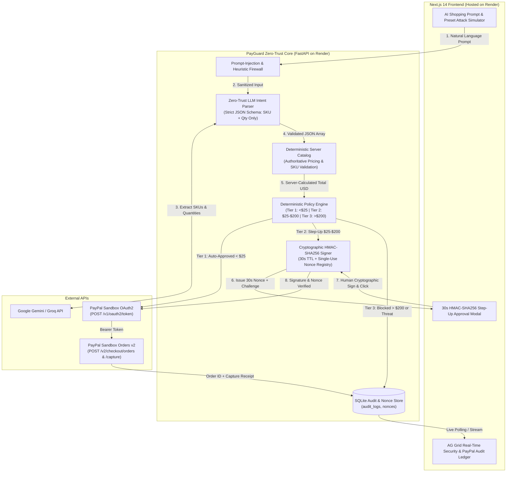

# PayGuard: Zero-Trust Cryptographic Safety Layer for Agentic Commerce

**Submission for the PayPal AI Hackathon**

---

## 1. Project Overview & Problem Statement

### The Problem: The Trust Deficit in Agentic Commerce
Consumers already rely on AI assistants to research, compare, and discover products, yet almost nobody trusts an autonomous agent with direct access to their wallet:
* **Only 9%** of consumers are willing to let an AI agent complete purchases autonomously (*Accenture survey of 25,590 consumers*).
* **55%** of shoppers report being explicitly uncomfortable letting an AI agent finalize a transaction (*Riskified survey of 2,000 shoppers*).
* **70%** of adults state that a single unauthorized or hallucinated agent transaction would permanently destroy their willingness to use AI shopping tools (*YouGov / ACI Worldwide*).

Large Language Models (LLMs) are probabilistic by nature—they are vulnerable to prompt injection, price hallucinations, and context manipulation. Connecting an LLM directly to a payment API creates an unacceptable financial attack surface. **Trust and deterministic control—not AI capability—are the true bottlenecks to agentic commerce.**

### The Solution: PayGuard
**PayGuard** is a zero-trust deterministic policy firewall and cryptographic human-in-the-loop (HITL) safety layer that sits between an AI Shopping Agent and the **PayPal Orders v2 API**. 

Users describe what they want to buy in natural language. PayGuard strictly isolates the LLM to **intent extraction only** (mapping free text to catalog SKU IDs and quantities). The LLM never touches prices, discounts, budget thresholds, or payment execution. Every request passes through a deterministic server-side policy engine, an anti-prompt-injection firewall, and a cryptographic **HMAC-SHA256 single-use 30-second nonce approval engine** before executing real itemized transactions on the **PayPal Sandbox Platform**. Every decision, signature, and PayPal state transition is streamed into a real-time **AG Grid** security audit ledger.

---

## 2. Core System Architecture



---

## 3. Repository Structure

```text
PAYPAL/
├── .env                        # Live environment variables (paste your API keys here)
├── .env.example                # Environment variable template
├── render.yaml                 # Render Infrastructure-as-Code Blueprint (payguard-api + payguard-web)
├── backend/                    # FastAPI Zero-Trust Core
│   ├── main.py                 # REST API endpoints (/api/agent/shop, /api/agent/approve, /api/audit-logs, /api/catalog)
│   ├── security_engine.py      # Prompt-Injection Firewall, Zero-Trust LLM Parser, Policy Engine, HMAC-SHA256 Signer
│   ├── paypal_client.py        # PayPal Sandbox OAuth2 + Orders v2 Create & Capture with PayPal-Request-Id idempotency
│   ├── catalog.py              # Immutable server-side product catalog (12 SKUs across Tiers 1, 2, 3)
│   ├── database.py             # SQLite audit_logs & nonces store with atomic single-use nonce locking
│   ├── requirements.txt        # Python dependencies
│   └── tests/
│       └── test_payguard.py    # Automated pytest suite verifying all tiers and security mitigations
└── frontend/                   # Next.js 14 + Tailwind CSS + AG Grid (ag-grid-react) Dashboard
    ├── package.json
    └── src/
        ├── app/
        │   ├── layout.tsx
        │   ├── page.tsx        # Zero-Trust Control Center, Prompt Console & Preset Attack Simulator
        │   └── globals.css
        ├── components/
        │   ├── AuditGrid.tsx   # Live 9-Column AG Grid Security & PayPal Audit Ledger
        │   └── StepUpModal.tsx # 30s Countdown HMAC-SHA256 Challenge & Replay/Tamper Simulator
        └── types/
            └── payguard.ts
```

---

## 4. Quick Start & Adding Your Keys

### Step 1: Add Your API Keys to `.env`
Edit the root [`.env`](file:///d:/PROJECTS/PAYPAL/.env) file and paste your credentials:
```env
PAYPAL_CLIENT_ID=your_paypal_sandbox_client_id_here
PAYPAL_CLIENT_SECRET=your_paypal_sandbox_client_secret_here
GEMINI_API_KEY=your_google_gemini_api_key_here
GROQ_API_KEY=your_groq_api_key_here
HMAC_SERVER_SECRET=payguard_zero_trust_hmac_sha256_secret_key_change_in_prod_9f86d081
```
*(Note: PayGuard also works out-of-the-box before keys are added using its built-in deterministic NLP fallback parser and sandbox simulation mode, and automatically switches to live `PAYPAL_SANDBOX_LIVE` and `GEMINI_API` / `GROQ_API` as soon as keys are populated.)*

### Step 2: Run the Backend (`http://localhost:8000`)
```bash
cd backend
pip install -r requirements.txt
pytest
uvicorn main:app --reload --port 8000
```

### Step 3: Run the Frontend (`http://localhost:3000`)
```bash
cd frontend
npm install
npm run dev
```
